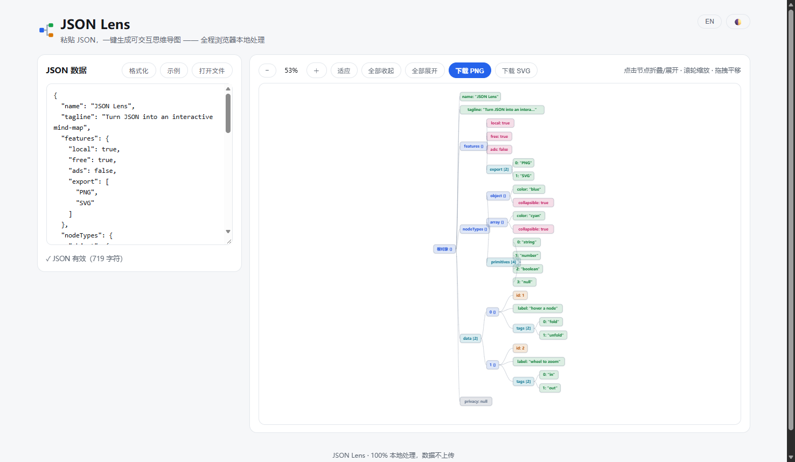
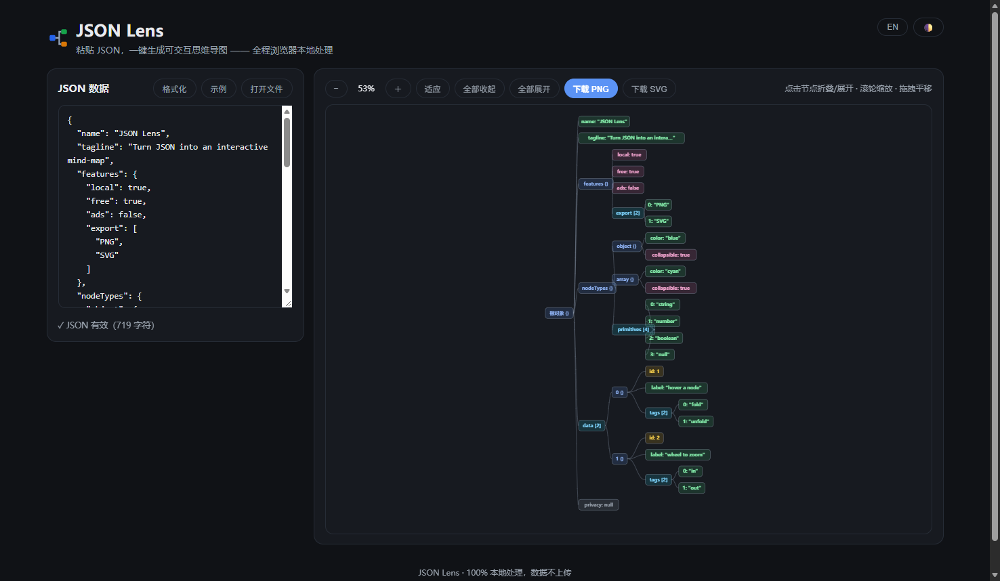

# JSON Lens

**[中文文档](README.zh-CN.md)**

<a href="https://bushimashen.github.io/json-lens/"><b>▶ Live demo</b></a>

Paste any JSON and instantly get an **interactive mind-map** — objects, arrays, strings, numbers, booleans and null each get their own color. Explore huge payloads by folding branches, zooming and panning, then export a crisp PNG or a vector SVG.

**Everything runs 100% locally in your browser. No server, no upload, no tracking — your data never leaves the page.**




## Features

- 🗺 **JSON → mind-map in one step** — paste, open a `.json` file, or just drag & drop it anywhere on the page; the map renders automatically as you type (debounced)
- 🎨 **Type-colored nodes** — object (blue), array (cyan), string (green), number (amber), boolean (pink), null (grey)
- 🖱 **Interactive exploring** — click any node to fold/unfold (a `+N` badge shows how many descendants are hidden); mouse-wheel zoom, drag to pan, one-click *Fit*
- 🔍 **Smart guards for huge payloads** — branches deeper than level 12 and sibling lists longer than 200 are auto-truncated with an explicit `… omitted` node, so a 10 MB API dump can't freeze the layout
- 🖼 **Export** — 2× PNG or true vector SVG, baked with the current theme colors
- 🌓 **Light / dark theme** — remembers your choice, follows system preference on first visit
- 🌐 **Bilingual UI** — Chinese / English, auto-detected from browser language
- 📦 **Zero dependencies, zero build** — one `index.html` file, works offline via `file://`

## Quick Start

No installation, no build step:

1. Download this repository (or just `index.html`)
2. Double-click `index.html` — that's it

Prefer serving it locally (optional):

```bash
cd json-lens
python -m http.server 8000        # or: npx serve
# open http://localhost:8000
```

### Usage

| Action | How |
| --- | --- |
| Load JSON | Paste into the editor / click **Open file** / drag & drop a `.json` file onto the page |
| Fold / unfold a branch | Click the node (a `+N` badge appears when children are hidden) |
| Zoom | Mouse wheel (centered on cursor) or the − / ＋ buttons |
| Pan | Drag anywhere on the canvas |
| Fit to view | **Fit** button |
| Collapse / expand everything | Toolbar buttons |
| Format input JSON | **Format** button |
| Export | **Download PNG** / **Download SVG** |
| Theme / language | Top-right buttons 🌓 / EN |

### Good to know

- Values are truncated for readability: strings over 24 characters are cut with `…`
- `JSON.parse` errors are shown inline with the raw browser message, so you can fix the payload fast
- The whole app is a single self-contained HTML file (~34 KB) — easy to audit, easy to host anywhere (GitHub Pages, object storage, a company intranet…)

## Repository Layout

```
json-lens/
├── index.html          # the entire app (HTML + CSS + JS, no dependencies)
├── README.md           # English doc (this file)
├── README.zh-CN.md     # 中文文档
├── LICENSE             # MIT
└── docs/               # screenshots
```

## How It Works (in 30 seconds)

`index.html` contains three small layers:

1. **Parse & shape** — `JSON.parse` the input, then recursively convert it into a `{label, type, children}` tree (with depth/sibling guards)
2. **Layout** — a classic horizontal tidy-tree pass assigns x/y coordinates (fixed row height, measured label widths)
3. **Render & interact** — plain SVG DOM nodes with pointer handlers for folding, panning and cursor-anchored zoom; export clones the SVG with theme colors baked in

No frameworks, no virtual DOM, no state library — just ~700 lines of dependency-free JavaScript.

## License

[MIT](LICENSE) © 2026 bushimashen
